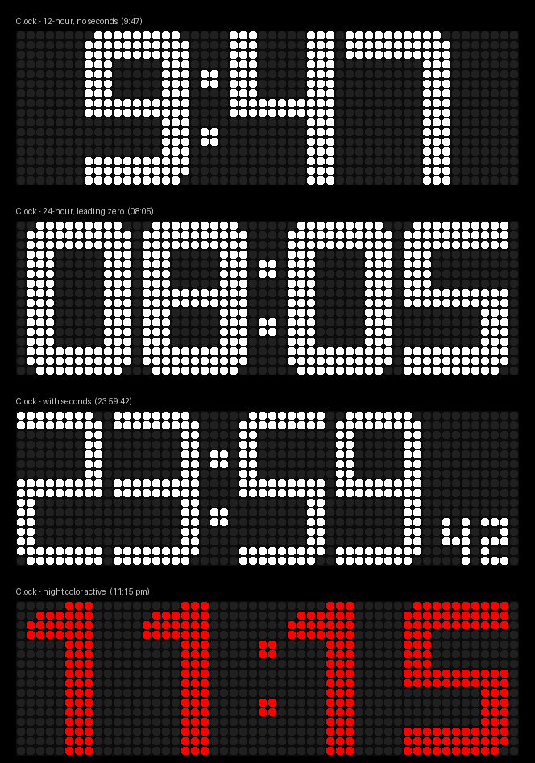

# BigClock

**The biggest clock the Ulanzi TC002 (52×16) can show.** HH:MM in full-height 16-pixel digits, with a
solid colon that never blinks. Optional small seconds and a night color.

AWTRIX NG's built-in fonts are at most 8 pixels tall, so BigClock draws its own digits from solid
blocks. That makes them twice the size of any font on the clock.

> **Needs AWTRIX NG on a 52×16 panel (TC002).** It won't fit a 32×8 TC001.

---

## Install

1. Open the AWTRIX web interface (the clock's IP address, or `http://awtrixng-xxxxxx.local`).
2. Go to the **Scripts** tab and create a new script named `BigClock`.
3. Paste in all of `BigClock.ax` and press **Save** (or Ctrl-S).
4. It joins the app rotation a moment later. Turn the knob to skip ahead to it.

**Tip:** turn off the built-in Time app if you don't want two clocks in the rotation.

**Changing settings:** Apps tab → the **gear** on BigClock's row. Saving restarts the app.

---

## Settings

| Group | Setting | Default | What it does |
|---|---|---|---|
| Time format | **24-hour time** | off | Off: 12-hour (1–12). On: 0–23. |
| Time format | **Leading zero** | off | `09:05` instead of `9:05`. Minutes always have two digits. |
| Time format | **Show seconds** | off | Hours and minutes stay full height (a bit narrower). Seconds show small in the bottom-right corner. |
| Color | **Custom color** | off | Off: uses the device's **time color** if set, otherwise the **global text color** (same rule as the built-in Time app). |
| Color | **Day color** | white | Used only when Custom color is on. |
| Night time | **Use night color** | off | Switches to the night color between the two times below. |
| Night time | **Night color** | red | Color during the night range. |
| Night time | **Night starts** | `22:00` | Start of the night range. |
| Night time | **Night ends** | `07:00` | End of the night range. |

**Every field is always visible.** AWTRIX NG can't hide settings based on other settings, so the color
pickers are simply ignored until their checkbox is on.

**Night color works with Custom color off too.** Day then uses the device or global color, and night
uses your night color.

## Layouts

- **No seconds:** four 11×16 px digits with 3-pixel strokes fill 50 of the 52 columns. `9:47` (12-hour,
  no leading zero) is centred.
- **With seconds:** HH:MM uses 9×16 px digits. Seconds are 3×5 px in the bottom-right corner.
- **Colon:** two solid 2×2 dots, never blinks.
- **12-hour mode** shows no AM/PM marker.

## Night time range

- Type times as 24-hour `HH:MM`, like `22:00` or `07:30`. `2200`, `7`, `10pm` and `10:30 PM` also work.
- A range can cross midnight (`22:00` → `07:00`) or sit within one day (`09:00` → `17:00`).
- The start time counts as night; the end time is already day.
- If a time can't be read, or both times are the same, the night color never turns on.
- The color switches within about a second of the start or end time.

---

## Troubleshooting

If the panel shows **`ERR:BigClock`** in red, the Scripts tab shows the error and its line number next
to the script. Open an issue with that message and your settings.

## Notes

- Tested against the AWTRIX NG 1.2.3 scripting API and a pixel-for-pixel reference renderer across
  every option combination. Nothing draws outside the 52×16 panel.
- `draw()` only paints. The color is picked in `loop()` about once a second.
- Doesn't change any device setting.
