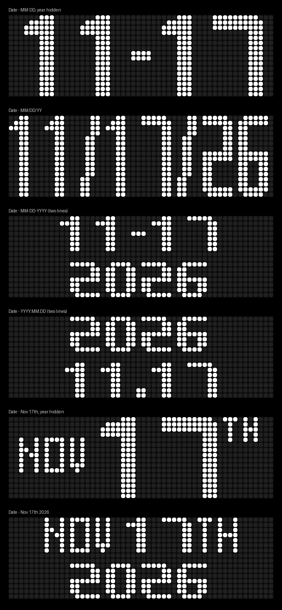

# BigDate

**The biggest date the Ulanzi TC002 (52×16) can show.** You pick the format and BigDate picks the largest
layout that fits it, up to full-height 16-pixel digits. Optional night color.

AWTRIX NG's built-in fonts are at most 8 pixels tall, so BigDate draws its own digits from solid blocks.

> **Needs AWTRIX NG on a 52×16 panel (TC002).** It won't fit a 32×8 TC001.

---

## Install

1. Open the AWTRIX web interface (the clock's IP address, or `http://awtrixng-xxxxxx.local`).
2. Go to the **Scripts** tab and create a new script named `BigDate`.
3. Paste in all of `BigDate.ax` and press **Save** (or Ctrl-S).
4. It joins the app rotation a moment later. Turn the knob to skip ahead to it.

**Tip:** turn off the built-in Date app if you don't want two dates in the rotation.

**Changing settings:** Apps tab → the **gear** on BigDate's row. Saving restarts the app.

---

## Settings

| Group | Setting | Default | Options |
|---|---|---|---|
| Date format | **Format** | `MM-DD-YYYY` | `MM-DD-YYYY`, `DD-MM-YYYY`, `YYYY-MM-DD`, `Nov 17th` |
| Date format | **Date separator** | `Dash (-)` | `Dot (.)`, `Dash (-)`, `Slash (/)`, `Backslash (\)`, `Pipe (\|)`. Not used by `Nov 17th`. |
| Date format | **Year digits** | `4 digits` | `Hidden`, `2 digits`, `4 digits`. Applies to every format, including `Nov 17th`. |
| Color | **Custom color** | off | Off: uses the device's **global text color**, so changing that changes the date. |
| Color | **Color** | white | Used only when Custom color is on. |
| Night time | **Use night color** | off | Switches to the night color between the two times below. |
| Night time | **Night color** | red | Color during the night range. |
| Night time | **Night starts** / **Night ends** | `22:00` / `07:00` | The night range. |

**Every field is always visible.** AWTRIX NG can't hide settings based on other settings, so the color
pickers are simply ignored until their checkbox is on.

**Night color works with Custom color off too.** Day then uses the global text color, and night
uses your night color.

## Layouts

**The layout follows the Year digits setting**, so it always uses the biggest size that fits:

| Year digits | Numeric formats | `Nov 17th` |
|---|---|---|
| Hidden | One line, 10×16 px digits: `11-17` | Month name, 16-px day, raised suffix: `NOV 17ᵀᴴ` |
| 2 digits | One line, 6×16 px digits: `11-17-26` | Two lines: `NOV 17TH` / `26` |
| 4 digits | Two lines, bold 6×7 px digits: `11-17` / `2026`. `YYYY-MM-DD` puts the year on top. | Two lines: `NOV 17TH` / `2026` |

- **Year hidden:** `MM-DD-YYYY` and `YYYY-MM-DD` both show `MM-DD`; `DD-MM-YYYY` shows `DD-MM`.
- **Month names and suffixes** follow the device's **Uppercase** setting: `NOV 17TH` when on,
  `Nov 17th` when off.

## Night time range

- Type times as 24-hour `HH:MM`, like `22:00` or `07:30`. `2200`, `7`, `10pm` and `10:30 PM` also work.
- A range can cross midnight (`22:00` → `07:00`) or sit within one day (`09:00` → `17:00`).
- The start time counts as night; the end time is already day.
- If a time can't be read, or both times are the same, the night color never turns on.
- The color switches within about a second of the start or end time.

---

## Troubleshooting

If the panel shows **`ERR:BigDate`** in red, the Scripts tab shows the error and its line number next
to the script. Open an issue with that message and your settings.

## Notes

- Tested against the AWTRIX NG 1.2.3 scripting API and a pixel-for-pixel reference renderer across
  every option combination. Nothing draws outside the 52×16 panel.
- `draw()` only paints. The layout is worked out when the date changes and once a minute; the color is
  picked in `loop()` about once a second.
- Doesn't change any device setting.
